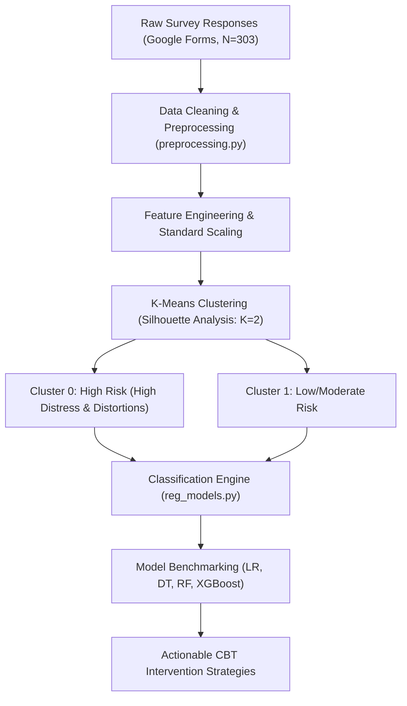

# Analysis of Cognitive Behavioural Patterns Among Students Using Data Analytics

[](https://www.python.org/)
[](https://scikit-learn.org/)
[](https://xgboost.readthedocs.io/)
[](#)

A research project combining principles of **Cognitive Behavioural Therapy (CBT)** with **Data Analytics & Machine Learning** to identify cognitive distortion patterns, segment student risk levels, and build predictive classifiers for early, data-driven mental health support.

---

## 📌 Table of Contents
- [Executive Summary](#-executive-summary)
- [Authors & Affiliation](#-authors--affiliation)
- [Theoretical Framework: Cognitive Distortions](#-theoretical-framework-cognitive-distortions)
- [System Architecture & Workflow](#-system-architecture--workflow)
- [Repository Layout](#-repository-layout)
- [Experimental Results](#-experimental-results)
  - [1. Unsupervised Clustering (K-Means)](#1-unsupervised-clustering-k-means)
  - [2. Supervised Classification Benchmarks](#2-supervised-classification-benchmarks)
  - [3. Cognitive Distortion Ranking](#3-cognitive-distortion-ranking)
- [Installation & Usage](#-installation--usage)
- [Key Insights & Recommendations](#-key-insights--recommendations)
- [References](#-references)

---

## 📖 Executive Summary
Traditional mental health assessments among university students often suffer from subjective bias and underreporting. This project establishes an automated, data-driven framework to:
1. Preprocess and analyze student psychological survey data ($N = 303$).
2. Quantitatively measure **five core CBT cognitive distortions** along with anxiety and depression levels.
3. Discover student risk profiles via **K-Means Clustering** (Silhouette score validated).
4. Predict student risk clusters using supervised classifiers (**Logistic Regression**, **Decision Tree**, **Random Forest**, and **XGBoost**).

---

## 🎓 Authors & Affiliation
* **Jeslyn Nivedhitha S** (Roll No: 22X020)
* **Richa Infanta J** (Roll No: 22X037)
* **Guide:** Dr. S. Poomagal, Associate Professor
* **Institution:** Department of Applied Mathematics and Computational Sciences, PSG College of Technology (Autonomous), Coimbatore – 641004.
* **Degree:** Bachelor of Science in Computer Systems and Design, Anna University (April 2025).

---

## 🧠 Theoretical Framework: Cognitive Distortions
The study evaluates five major cognitive distortions identified in clinical CBT literature:
* **Black-and-White Thinking (All-or-Nothing):** Viewing situations in extreme absolutes with no middle ground (*"If I am not perfect, I am a failure"*).
* **Overgeneralization:** Drawing broad negative conclusions from single isolated incidents (*"I failed once, so I'll always fail"*).
* **Personalization:** Inappropriately attributing external events or others' behaviors to oneself (*"They didn't invite me, so they must dislike me"*).
* **Catastrophizing:** Anticipating the worst conceivable outcome in any situation (*"If I score low on this test, my career is ruined"*).
* **Rigid 'Should' Statements:** Holding rigid, inflexible standards leading to guilt, shame, and burnout (*"I should never make mistakes"*).

---

## ⚙️ System Architecture & Workflow



---

## 📁 Repository Layout

```text
.
├── README.md                                  # Comprehensive documentation & results
├── requirements.txt                           # Python package dependencies
├── .gitignore                                 # Git ignore configuration
│
├── data/
│   ├── raw/
│   │   └── original_student_gform.csv         # Raw survey responses (303 records)
│   └── processed/
│       ├── original_preprocessed_student_mental_health_data.csv
│       └── original_clustered_student_mental_health_data.csv
│
├── src/
│   ├── preprocessing.py                       # String standardization, regex, & imputation
│   ├── k_means.py                             # Clustering, silhouette scores, & EDA plots
│   └── reg_models.py                          # Supervised classifier training & metrics
│
├── docs/
│   ├── Report.pdf                             # Complete project dissertation report
│   ├── SYNOPSIS.docx                          # Academic synopsis
│   ├── ABSTRACT_FINAL_YEAR.docx               # Research abstract
│   ├── FINAL YEAR PROJECT IDEAS.docx          # Project proposals & conceptual notes
│   ├── Original_codes.docx                    # Source code documentation
│   ├── presentations/                         # Review & Viva presentations
│   │   ├── Project_Review_1.pptx
│   │   ├── Project_Review_2.pptx
│   │   └── Project_Viva.pptx
│   └── references/                            # Academic literature references (PDFs)
│
└── results/
    ├── final_conclusion.txt                   # Quantitative summary output
    └── plots/                                 # Visualizations & evaluation charts
        ├── silhouette_score.png
        ├── cluster_profiles.png
        ├── cluster_pair_plot.png
        ├── model_comparison_accuracy.png
        ├── Logistic_Regression_confusion_matrix.png
        ├── Decision_Tree_confusion_matrix.png
        ├── Random_Forest_confusion_matrix.png
        └── XGBoost_confusion_matrix.png
```

---

## 📊 Experimental Results

### 1. Unsupervised Clustering (K-Means)
* **Optimal Clusters:** Evaluated across $K \in [2, 10]$ via Silhouette Coefficient. Optimal score achieved at **$K = 2$** ($\text{Silhouette Score} \approx 0.30$).
* **Cluster Profiles:**
  * **Cluster 0 (High Risk Group):** High Anxiety ($\mu = 3.01$), High Depression ($\mu = 2.77$), and significantly elevated scores across all cognitive distortion metrics.
  * **Cluster 1 (Low Risk Group):** Moderate Anxiety ($\mu = 2.07$), Moderate Depression ($\mu = 2.05$).

### 2. Supervised Classification Benchmarks
The dataset was partitioned into 80% training and 20% testing subsets to evaluate cluster predictability:

| Model | Accuracy | Precision (C0 / C1) | Recall (C0 / C1) | F1-Score (C0 / C1) | Misclassifications |
| :--- | :---: | :---: | :---: | :---: | :---: |
| **XGBoost Classifier** | **100.00%** | **1.00 / 1.00** | **1.00 / 1.00** | **1.00 / 1.00** | **0** |
| **Logistic Regression** | **98.36%** | 1.00 / 0.97 | 0.96 / 1.00 | 0.98 / 0.99 | 1 |
| **Random Forest** | **98.36%** | 1.00 / 0.97 | 0.96 / 1.00 | 0.98 / 0.99 | 1 |
| **Decision Tree** | **91.80%** | 0.95 / 0.90 | 0.82 / 0.97 | 0.88 / 0.94 | 5 |

### 3. Cognitive Distortion Ranking
Average observed scores across all survey respondents (0–4 scale):

| Rank | Distortion Type | Mean Score | Dominant Cluster |
| :---: | :--- | :---: | :---: |
| 1 | **Black & White Thinking** | **1.92** | Cluster 0 |
| 2 | **Personalization** | **1.84** | Cluster 0 |
| 3 | **Should Statements** | **1.78** | Cluster 0 |
| 4 | **Catastrophizing** | **1.73** | Cluster 0 |
| 5 | **Overgeneralization** | **1.67** | Cluster 0 |

---

## 🚀 Installation & Usage

### 1. Clone the Repository & Install Dependencies
```bash
git clone https://github.com/<your-username>/student-cognitive-distortion-analytics.git
cd student-cognitive-distortion-analytics
pip install -r requirements.txt
```

### 2. Run Data Preprocessing
```bash
python src/preprocessing.py
```
*Cleans survey text, handles missing entries, encodes Likert metrics, and outputs `data/processed/original_preprocessed_student_mental_health_data.csv`.*

### 3. Run K-Means Clustering & Visualizations
```bash
python src/k_means.py
```
*Performs silhouette analysis, determines clusters, creates heatmaps/pair plots, and outputs `data/processed/original_clustered_student_mental_health_data.csv`.*

### 4. Run Model Training & Evaluation
```bash
python src/reg_models.py
```
*Trains and benchmarks ML classifiers, creates confusion matrices, and writes results to `results/final_conclusion.txt`.*

---

## 💡 Key Insights & Recommendations
1. **Targeted CBT Restructuring:** Since *Black-and-White Thinking* and *Personalization* are the primary drivers of psychological distress in high-risk students, mental health programs should emphasize thought reframing exercises and cognitive restructuring worksheets.
2. **Proactive Campus Screening:** Automated screening using machine learning models (e.g., XGBoost) can assist student counseling centers in identifying students needing timely support before symptoms escalate.
3. **Resilience Workshops:** Institutional mindfulness, thought journaling, and CBT-informed group workshops can substantially enhance student emotional regulation and academic resilience.

---

## 📚 References
1. **You et al. (2022):** *Efficacy and Cost-Effectiveness Analysis of Internet-Based Cognitive Behavioral Therapy: Randomized Controlled Trial.*
2. **Khurshid et al. (2025):** *CBT’s Impact on Procrastination, Burnout, and Anxiety in Adolescents.*
3. **Jiang et al. (2024):** *AI-Enhanced Cognitive Behavioral Therapy: Deep Learning and Large Language Models for Extracting Cognitive Pathways.*
4. **Vuyyuru et al. (2023):** *A Transformer-CNN Hybrid Model for Cognitive Behavioral Therapy in Psychological Assessment.*
